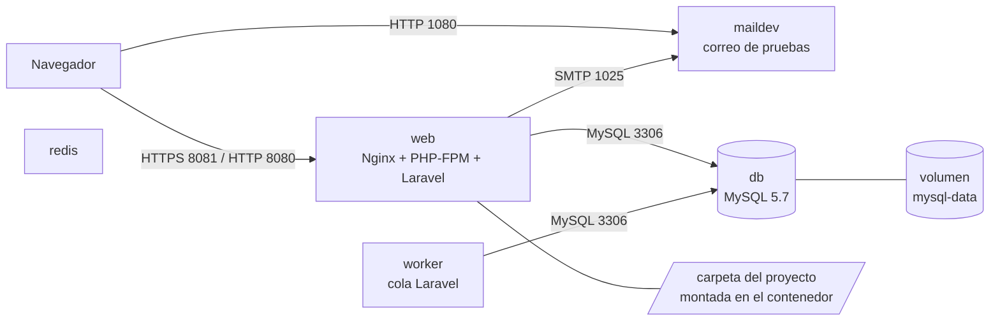

# Tarea 1 · Despliegue local de Attendize con Docker

Despliegue local y reproducible de **Attendize v2.8.0** con Docker Compose, MySQL y GitHub.
Proyecto Intermodular II · IES Juan de Garay · 2.º DAW.

- **Autor:** Pablo Moret Alcarria
- **Repositorio oficial de Attendize:** https://github.com/Attendize/Attendize
- **Versión de partida:** etiqueta oficial `v2.8.0` (commit `47997d2`), copiada en la etiqueta `tarea-01-inicio`
- **Rama de trabajo:** `tarea-01-despliegue`
- **Versión entregada:** etiqueta `tarea-01-entrega`

---

## 1. Requisitos previos

| Requisito | Versión usada |
|---|---|
| Sistema operativo | Windows versión 25H2 |
| Docker Desktop / Engine | version 29.8.0 |
| Docker Compose | versión 5.5.1 |
| Git | versión 2.51.8.windows.2 |
| Puertos libres en el equipo | **3306**, **8080**, **8081**, **1080** |

El puerto 3306 debe estar libre: si hay un MySQL local en marcha, hay que detenerlo antes (ver problema 3).

---

## 2. Arquitectura del entorno

### Servicios (`docker-compose.yml`)

| Servicio | Imagen | Función | Puertos publicados en el equipo |
|---|---|---|---|
| `web` | `attendize_web` (construida con el `Dockerfile`, destino `web`) | Nginx + PHP-FPM con Laravel | `8080`→80 (HTTP), `8081`→443 (HTTPS) |
| `worker` | `attendize_worker` (destino `worker`) | Cola de tareas de Laravel | ninguno |
| `db` | `mysql:5.7.23` | Base de datos MySQL | `3306`→3306 |
| `redis` | `redis` | Servicio auxiliar de caché/colas | ninguno (6379 solo en la red interna) |
| `maildev` | `maildev/maildev` | Servidor de correo de pruebas | `1080`→1080 (interfaz web) |

- **Red:** `attendize_default`, creada por Compose. Los contenedores se localizan por el nombre del servicio (`db`, `redis`, `maildev`).
- **Volúmenes:**
  - `attendize_mysql-data`: datos de MySQL (`/var/lib/mysql`). Es lo que hace que los datos persistan.
  - Montaje de la carpeta del proyecto (`.`) sobre `/usr/share/nginx/html` en `web` y `worker`.
- **Nota:** con el `.env` por defecto, Attendize usa `CACHE_DRIVER=file`, `SESSION_DRIVER=file` y `QUEUE_CONNECTION=sync`. Redis está desplegado pero la configuración por defecto no lo utiliza.

### Esquema



---

## 3. Variables de entorno

Se copian de `.env.example`. El archivo `.env` **no se sube al repositorio**.

| Variable | Valor | Observación |
|---|---|---|
| `APP_ENV` / `APP_DEBUG` | `local` / `true` | Solo para uso local |
| `APP_URL` | `https://localhost:8081` | |
| `APP_KEY` | *(se genera)* | Secreto: se crea con `php artisan key:generate` y no se publica |
| `DB_HOST` | `db` | Nombre del servicio MySQL en la red de Docker |
| `DB_PORT` | `3306` | |
| `DB_DATABASE` / `DB_USERNAME` / `DB_PASSWORD` | `attendize` / `attendize` / `attendize` | Valores ficticios de desarrollo |
| `MAIL_HOST` / `MAIL_PORT` | `maildev` / `1025` | El correo no sale a Internet |
| `CACHE_DRIVER` / `SESSION_DRIVER` / `QUEUE_CONNECTION` | `file` / `file` / `sync` | |

---

## 4. Puesta en marcha

```bash
# 1. Clonar la versión entregada
git clone https://github.com/pabmoralc/Attendize.git
cd Attendize
git checkout tarea-01-entrega

# 2. Configuración
cp .env.example .env

# 3. Construir las imágenes
docker build --tag attendize_base --target base .
docker build --tag attendize_worker --target worker --cache-from attendize_base:latest .
docker build --tag attendize_web --target web --cache-from attendize_worker:latest .

# 4. Arrancar
docker compose up -d

# 5. Dependencias y clave (una sola vez)
docker compose exec web composer install --no-interaction
docker compose exec web php artisan key:generate
docker compose up -d --force-recreate web worker

# 6. Base de datos
docker compose exec web sh -c "wait-for-it db:3306 -t 180 && php artisan migrate"
```

Después, abrir `https://localhost:8081/install` (el navegador avisará del certificado autofirmado: *Avanzado → Continuar*).

> `key:generate` se ejecuta **una sola vez**. Tras generar la clave hay que **recrear** `web` y `worker` (ver problema 7).

### Comprobar, detener y reiniciar

```bash
docker compose ps                 # estado de los servicios
docker compose logs web --tail 40 # registros
docker compose stop               # detener (conserva los datos)
docker compose start              # reiniciar
docker compose down               # eliminar contenedores (conserva el volumen)
```

> **No usar `docker compose down -v`**: borra el volumen y con él la base de datos.

---

## 5. Primer acceso y datos ficticios

Datos de instalación (asistente `/install`): base de datos `db`, puerto `3306`, base `attendize`, usuario `attendize`, contraseña `attendize`; correo `maildev` puerto `1025`, sin cifrado ni credenciales.

Cuenta de prueba (ficticia):

| Dato | Valor |
|---|---|
| Correo | `prueba@example.com` |
| Contraseña | `Tarea1prueba` |
| Evento de prueba | `Prueba evento nº1` |

Acceso: `https://localhost:8081`. Los correos de prueba se ven en `http://localhost:1080`.

---

## 6. Problemas encontrados, decisiones, soluciones y limitaciones

### Problema 1: `apt-get update` falla al construir la imagen base
- **Comando:** `docker build --tag attendize_base --target base .`
- **Error:** `E: The repository 'http://deb.debian.org/debian buster Release' does not have a Release file` (404) y `EXPKEYSIG ... nginx signing key`.
- **Causa:** la imagen base `wyveo/nginx-php-fpm:php74` usa Debian 10 «buster», sin soporte. Sus repositorios se movieron a `archive.debian.org` y la clave de firma del repositorio de nginx caducó.
- **Solución:** en el `Dockerfile` se apuntó apt a `archive.debian.org`, se eliminaron las líneas de `buster-updates`, nginx y sury, y se desactivó la comprobación de validez de fechas solo en ese `apt-get update`.
- **Decisión:** mantener la imagen base y la versión v2.8.0 de Attendize, adaptando únicamente el Dockerfile.
- **Limitación:** la imagen base está obsoleta y no recibe parches de seguridad; solo es aceptable en local.
- **Commit:** `61bb9dd`

### Problema 2: `./scripts/setup: not found` (código 127)
- **Error:** `/bin/sh: 1: ./scripts/setup: not found`
- **Causa (probable):** finales de línea CRLF en el script al clonar en Windows; el intérprete del script se lee como `/bin/bash\r`. En el repositorio oficial el archivo tiene finales LF.
- **Solución:** en el `Dockerfile`, `sed -i 's/\r$//'` y `chmod +x` sobre el script antes de ejecutarlo.
- **Commit:** `61bb9dd`

### Problema 3: el puerto 3306 del equipo estaba ocupado
- **Comando:** `docker compose up -d`
- **Error:** `ports are not available: exposing port TCP 0.0.0.0:3306 ... Only one usage of each socket address ... is normally permitted.` Un intento con el puerto 3307 falló igual.
- **Diagnóstico:** `netstat -ano | grep -E ":(3306|3307|3308)"` mostró ambos puertos en `LISTENING` (PID 7072 y 5772). `tasklist` confirmó que los dos procesos eran `mysqld.exe`: dos servidores MySQL instalados en Windows.
- **Solución:** detener los servicios MySQL de Windows con `Stop-Service` (PowerShell de administrador) y ponerlos en inicio manual con `Set-Service -StartupType Manual`, porque al reiniciar el equipo volvían a arrancar y a ocupar el puerto. `docker-compose.yml` quedó con el mapeo original `3306:3306`.
- **Decisión:** liberar el puerto 3306 en lugar de cambiar el mapeo del proyecto, para mantener la configuración por defecto de Attendize.
- **Aprendizaje:** un `LISTENING` en el 3306 no siempre es un conflicto; con `tasklist` se comprueba el PID, y si es `com.docker.backend.exe` o `wslrelay.exe` es el propio contenedor `db`.
- **Limitación:** el proyecto necesita el 3306 libre. Quien tenga un MySQL local debe detenerlo o cambiar el mapeo (por ejemplo `"13306:3306"`).

### Problema 4: el contenedor `worker` se detiene
- **Comando:** `docker compose logs worker --tail 30`
- **Error:** `require(/usr/share/nginx/html/vendor/autoload.php): failed to open stream`
- **Causa:** el volumen `.:/usr/share/nginx/html` monta la carpeta del equipo sobre la de la imagen y oculta el `vendor/` instalado durante la construcción, porque el equipo no tiene `vendor/`.
- **Solución:** `docker compose exec web composer install --no-interaction`, que instala `vendor/` en la carpeta compartida, después, `docker compose restart worker`.
- **Limitación:** `vendor/` queda en el equipo (no se sube a Git) y hay que repetir el paso en una instalación limpia.

### Problema 5: `504 Gateway Time-out` en `/install`
- **Causa :** la primera petición es muy lenta por el montaje de la carpeta compartida entre Windows y el contenedor (`vendor/` tiene miles de archivos) y supera el límite de espera de nginx.
- **Solución:** esperar y recargar, las siguientes peticiones respondieron.

### Problema 6: `No application encryption key has been specified`
- **Causa (probable):** `APP_KEY` vacía en el entorno del contenedor. El `env_file` solo se lee al **crear** el contenedor, y un simple reinicio no lo actualiza.
- **Solución:** `docker compose up -d --force-recreate web worker`.

### Problema 7: clave de aplicación con longitud no válida
- **Error:** `The only supported ciphers are AES-128-CBC and AES-256-CBC with the correct key lengths.`
- **Diagnóstico:** `grep -c $'\r' .env` dio 0 (se descartó CRLF). La línea `APP_KEY` medía 111 caracteres y el valor dentro del contenedor 102; una clave válida de AES-256-CBC mide 51 (`base64:` + 44).
- **Causa (probable, no verificada directamente):** `key:generate` se ejecutó dos veces con el contenedor viendo `APP_KEY` vacía, de modo que la clave nueva se antepuso a la anterior. La longitud, justo el doble, encaja.
- **Solución:** vaciar la clave (`sed -i 's/^APP_KEY=.*/APP_KEY=/' .env`), recrear `web` y `worker`, ejecutar `key:generate` **una sola vez**, recrear de nuevo y `php artisan config:clear`. La línea `APP_KEY=` pasó a medir 60 (antes 111).

### Observaciones sin impacto
- `ERROR importing cache manifest from attendize_base:latest` al construir `worker` y `web`: `--cache-from` busca la caché en un registro y la imagen es solo local. No es bloqueante; el build termina reutilizando capas (`CACHED`).
- Aviso `the attribute 'version' is obsolete` de Compose: es solo informativo.

---

## 7. Evidencias

| Comprobación | Evidencia | Fecha |
|---|---|---|---|
| Imagen base construida | `docs/ERRORES/02-build-base-ok-tarea1.png` |
| Servicios iniciados | `docs/ERRORES/05-compose-ps-5-servicios.png` |
| Asistente `/install` | `docs/ERRORES/instalando-attendize.png` |
| Acceso con HTTPS e inicio de sesión | `docs/ERRORES/install-works.png` |
| Evento ficticio guardado en MySQL | `docs/ERRORES/evento-creado.png` | 
| Persistencia tras `stop`/`start` | `docs/ERRORES/evento-creado.png` | 

---

## 8. Seguridad

- `.env` y `vendor/` **no** están en el repositorio.
- Todas las credenciales de este documento son ficticias y válidas solo en local.
- `APP_KEY` no se publica.
